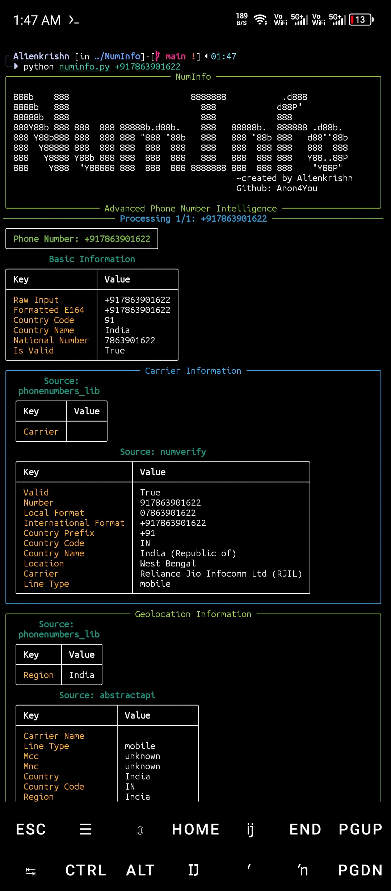

<div align="center">
  


# 🔍 NumInfo

### Advanced Phone Number Intelligence Tool

📡 A powerful Python tool for gathering comprehensive information about phone numbers using multiple APIs and data sources.

[](https://www.python.org/)
[](LICENSE)
[]()

</div>

---

## 📸 Screenshot

<details>
<summary>📱 Click/tap to view screenshot</summary>
<br>

</details>

---

## 🌟 Features

| Feature | Description |
|---------|-------------|
| ✅ **Phone Number Validation** | Verify if a number is valid and properly formatted |
| 📱 **Carrier Lookup** | Identify the service provider for any phone number |
| 🌍 **Geolocation** | Determine the country and region associated with a number |
| ⏰ **Timezone Detection** | Find the timezone(s) for a phone number |
| 📂 **Batch Processing** | Read multiple numbers from a file (`-f`) |
| 🔌 **API Integration** | Supports NumVerify and AbstractAPI (optional) |
| 📊 **Multiple Output Formats** | Colorful console output and JSON export |
| 🐞 **Verbose Mode** | Detailed debug output with `-v` |
| 🎨 **No‑Color Option** | Disable colored output for scripting (`--no-color`) |
| 🔒 **Privacy Focused** | Only uses publicly available information |

---

## 🛠️ Installation

```bash
# Clone the repository
git clone https://github.com/Anon4You/NumInfo.git
cd NumInfo

# Install dependencies
pip install -r requirements.txt

# (Optional) Set up environment variables for API features
cp .env.example .env
# Edit .env with your API keys
```

---

## 🚀 Usage

### Basic Usage
```bash
python numinfo.py +1234567890
```

### Process Multiple Numbers
```bash
python numinfo.py -f numbers.txt
```

### Save Results to JSON
```bash
python numinfo.py +1234567890 -o results.json
```

### Enable Verbose Mode
```bash
python numinfo.py +1234567890 -v
```

### Disable Colors
```bash
python numinfo.py +1234567890 --no-color
```

---

## ⚙️ Command Line Options

```
positional arguments:
  phone_number          Phone number(s) to investigate (include country code)

optional arguments:
  -h, --help            show this help message and exit
  -f FILE, --file FILE  File containing phone numbers (one per line)
  -o OUTPUT, --output OUTPUT
                        Output file name (JSON format)
  -v, --verbose         Enable verbose debug output
  --no-color            Disable colored output
```

---

## 🔑 API Integration

For enhanced features, obtain API keys from:

| API | Purpose | Link |
|-----|---------|------|
| NumVerify | Carrier details | [Get API Key](https://numverify.com/) |
| AbstractAPI | Geolocation | [Get API Key](https://www.abstractapi.com/) |

Add your keys to the `.env` file:

```env
NUMVERIFY_API_KEY=your_key_here
ABSTRACT_API_KEY=your_key_here
```

---

## 📜 License

Distributed under the MIT License. See [LICENSE](LICENSE) for more information.

---

<div align="center">

**Made with ❤️ by [Anon4You](https://github.com/Anon4You)**

</div>
